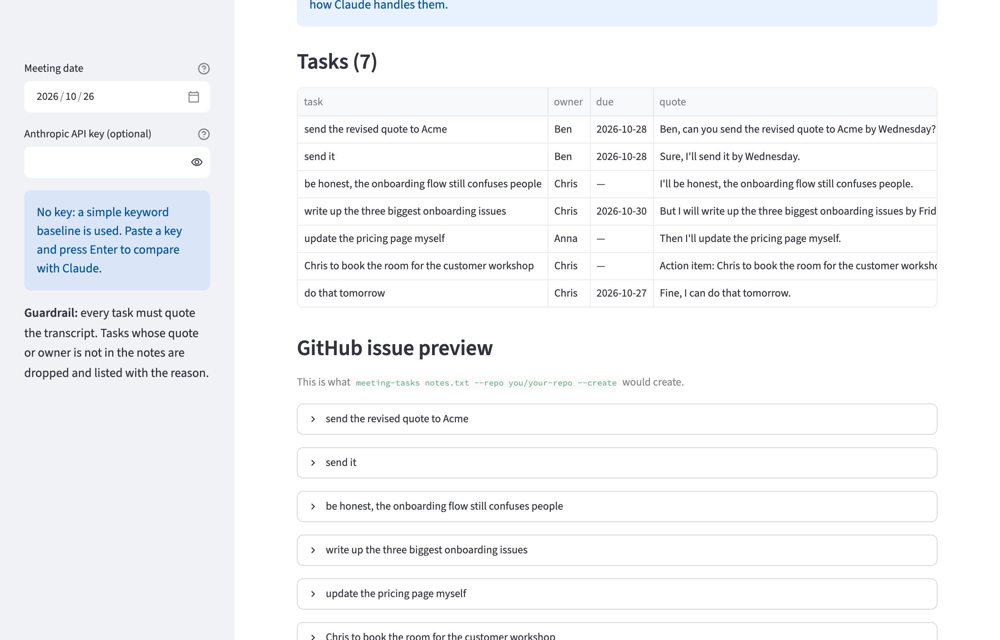

# meeting-tasks

Turn meeting notes into **GitHub Issues**. An LLM (Claude) reads the notes and extracts every action
item with owner, due date and the sentence it came from. A guardrail drops any task whose quote or
owner is not actually in the notes, so nothing invented ends up in your backlog. A labeled eval
measures precision and recall against a keyword baseline.

## Preview

Paste meeting notes, pick the meeting date (for deadlines like "Friday") and click **Extract tasks**:


The result: a task table with owner, due date and supporting quote, plus a preview of each GitHub issue.
This screenshot shows the keyword baseline (no API key), including the mistakes the eval is built to catch,
like "be honest…" counted as a task and the quote request counted twice:



## Run it locally (step by step)

You need **Python 3.10+** and **git**. The demo runs on your own machine and never writes to GitHub.

1. Get the code:
   ```bash
   git clone https://github.com/ExNNeph/meeting-tasks.git
   cd meeting-tasks
   ```
2. Create and activate a virtual environment, so nothing is installed system-wide:
   ```bash
   python3 -m venv .venv
   source .venv/bin/activate          # Windows: .venv\Scripts\activate
   ```
3. Install the project with the demo extras:
   ```bash
   pip install -e ".[demo]"
   ```
4. Start the demo:
   ```bash
   meeting-tasks demo
   ```
   Your browser opens **http://localhost:8501**. If it does not, open that address yourself.
5. Stop it with `Ctrl-C` in the terminal. Next time, only steps 2 (`source .venv/bin/activate`) and 4 are needed.

Things to try in the demo:
- Click **Extract tasks** on the sample meeting: without a key you see the keyword baseline and its mistakes.
- Paste your Anthropic key in the sidebar and **press Enter** (used for this session only, never stored),
  then extract again: Claude skips "I'll be honest", the declined pricing-page task and the finished bug fix.
- Edit the notes, for example add `Ben: I'll call the lawyer on Thursday.`, and extract again.
- Change the **meeting date**: relative deadlines like "Friday" move with it.
- Open an entry under **GitHub issue preview** to see the exact issue text.

## How it works

1. `extract.py`: Claude gets the notes plus the meeting date and returns JSON through
   **structured outputs** (`output_config.format` with a JSON schema), so the response always parses.
   Each task is then validated with Pydantic.
2. **Guardrail** (`grounded()`): every task must carry a quote that appears in the notes (compared
   ignoring case and punctuation) and an owner who is named in them. Anything else is dropped and
   reported with the reason. A wrong date format is dropped the same way.
3. If there is no API key or the call fails, a **keyword baseline** (`rule_extract()`) runs instead,
   so the tool still works offline. The same baseline is the comparison point in the eval.
4. `issues.py`: creates one GitHub issue per task through the `gh` CLI, so your existing
   `gh auth login` is used and no token passes through this tool. Open issues with the same title are
   skipped, so running it twice does not create duplicates.

## Command line (real use)

With the virtual environment from the steps above active and `gh auth login` done:

```bash
meeting-tasks notes.txt --date 2026-10-26                       # print the tasks
meeting-tasks notes.txt --repo you/your-repo                    # preview the issues, creates nothing
meeting-tasks notes.txt --repo you/your-repo --create           # create the issues
```

| Variable | Needed for |
|---|---|
| `ANTHROPIC_API_KEY` | Claude extraction (optional; without it the keyword baseline is used) |
| `MEETING_TASKS_MODEL` | override the model (default `claude-opus-5-5`) |

The request opts into the API's server-side refusal fallback (`fallbacks: "default"`), so a request
declined by a safety classifier is retried on a fallback model instead of failing.

## Evals

`evals/meetings/` holds four meetings with a hand-labeled answer key in `evals/gold.json`. Each one
contains traps that a naive extractor falls for:

| meeting | traps |
|---|---|
| product sync | "I'll be honest" (not a task), an idea nobody committed to, a declined task taken over by someone else, a bug that is already fixed, the same task said twice |
| engineering standup | a task handed from one person to another, work already done, "see you tomorrow" |
| client call | an idea that was skipped, a request that was declined |
| planning notes | bullet points without speaker names, a postponed topic, a decision deferred to January |

Predicted and labeled tasks are matched one-to-one by title (shared content words). Reported are
**precision** (share of found tasks that are real), **recall** (share of real tasks found), and for
matched tasks whether the **owner** and **due date** are right.

```bash
python evals/run_eval.py 3        # baseline; plus Claude when ANTHROPIC_API_KEY is set (3 runs per meeting)
pytest                            # unit tests + sanity checks on the answer key
```

## Results

`python evals/run_eval.py 3` (4 meetings, Claude 3 runs each):

| extractor | tasks found | precision | recall | F1 | owner correct | due date correct | guardrail drops |
|---|---|---|---|---|---|---|---|
| keyword baseline | 19 | 53% | 62% | 57% | 90% | 90% | 0 |
| Claude (`claude-opus-5-5`) + guardrail | 48 | **100%** | **100%** | **100%** | 100% | 100% | 0 |

The baseline finds most explicit commitments but also every "I'll be honest" and duplicate, and
nothing at all in notes without speaker names. Claude found all 16 tasks in every run, skipped every
trap, resolved every relative deadline and never needed the guardrail.

Cost: about 850 input and 415 output tokens per meeting, roughly $0.01 per meeting at Opus 5.5 prices.

**What 100% means:** this eval is now too easy to tell a good prompt from a better one. It proves the
traps are handled, not that the extractor is perfect. The next step is harder meetings: longer
transcripts, interruptions, tasks split across speakers, and implicit owners ("someone should…").

## Known limits

- The eval is small (4 meetings, 16 labeled tasks) and synthetic, written to contain known traps.
- Title matching is word overlap, so a correct task phrased very differently can count as a miss.
- Owners are first names as spoken. They are written into the issue body, not mapped to GitHub
  assignees.
- English notes only.

## License

MIT
