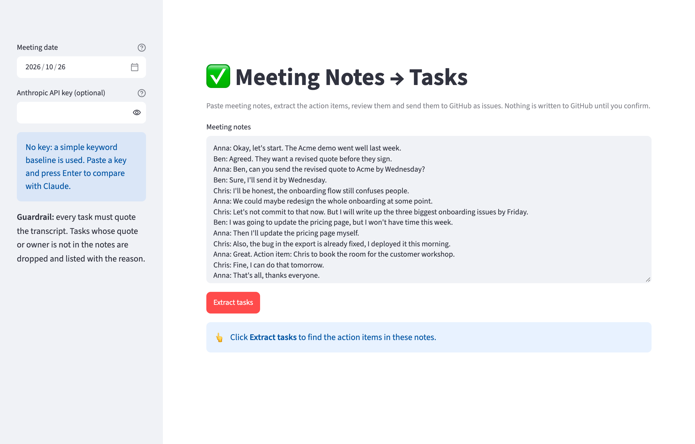
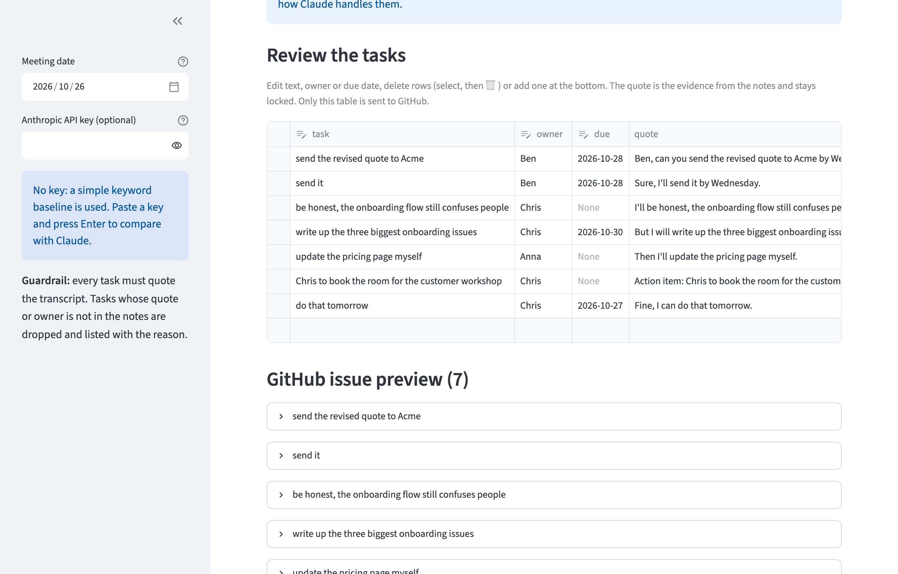
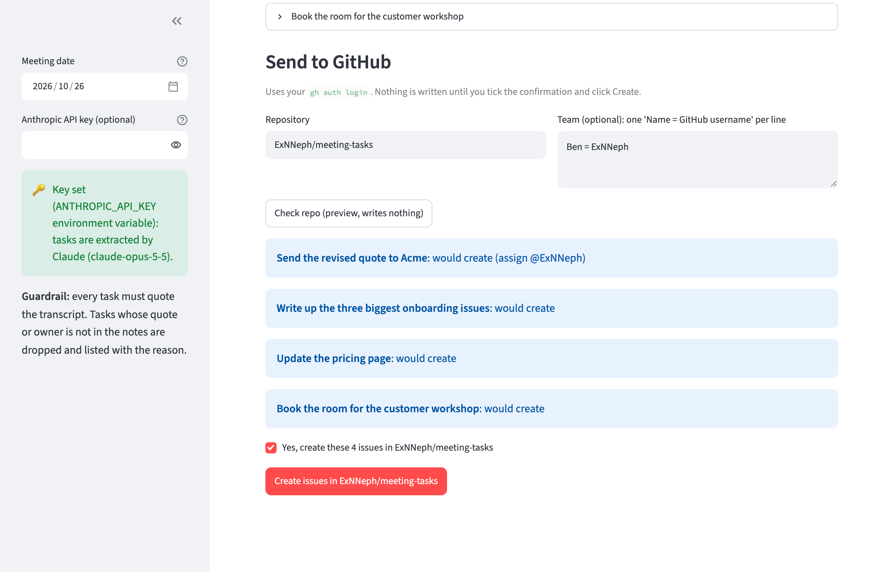

# meeting-tasks

Turn meeting notes into **GitHub Issues**. An LLM (Claude) reads the notes and extracts every action
item with owner, due date and the sentence it came from. A guardrail drops any task whose quote or
owner is not actually in the notes, so nothing invented ends up in your backlog. You review and edit
the tasks, then create them as labeled, assigned issues. A labeled eval measures precision and recall
against a keyword baseline, on a standard and a hard set of meetings.

## Preview

**1. Paste meeting notes**, pick the meeting date (for deadlines like "Friday") and click **Extract tasks**:



**2. Review the tasks.** Edit text, owner or due date, delete rows or add your own. The quote from the
notes stays locked as evidence, and the issue preview below always shows what will be sent. This
screenshot shows the keyword baseline (no API key) with the mistakes the eval is built to catch, like
"be honest…" counted as a task and the quote request counted twice, which you would delete here:



**3. Send to GitHub.** Enter the repository and optionally who is who on GitHub. "Check repo" shows
what would happen and writes nothing; issues are only created after an explicit confirmation:



## Run it locally (step by step)

You need **Python 3.10+** and **git**. The demo runs on your own machine and only writes to GitHub
after you confirm it under "Send to GitHub".

1. Get the code:
   ```bash
   git clone https://github.com/ExNNeph/meeting-tasks.git
   cd meeting-tasks
   ```
2. Create and activate a virtual environment, so nothing is installed system-wide:
   ```bash
   python3 -m venv .venv
   source .venv/bin/activate          # Windows: .venv\Scripts\activate
   ```
3. Install the project with the demo extras:
   ```bash
   pip install -e ".[demo]"
   ```
4. Start the demo:
   ```bash
   meeting-tasks demo
   ```
   Your browser opens **http://localhost:8501**. If it does not, open that address yourself.
5. Stop it with `Ctrl-C` in the terminal. Next time, only steps 2 (`source .venv/bin/activate`) and 4 are needed.

Things to try in the demo:
- Click **Extract tasks** on the sample meeting: without a key you see the keyword baseline and its mistakes.
- Paste your Anthropic key in the sidebar and **press Enter** (used for this session only, never stored),
  then extract again: Claude skips "I'll be honest", the declined pricing-page task and the finished bug fix.
- Edit the notes, for example add `Ben: I'll call the lawyer on Thursday.`, and extract again.
- Change the **meeting date**: relative deadlines like "Friday" move with it.
- In **Review the tasks**, delete the wrong rows, fix a title or add a task of your own: the
  **GitHub issue preview** follows immediately.
- Under **Send to GitHub**, enter a repository you own and click **Check repo**: it lists what would be
  created or skipped and writes nothing. Only the confirmation tick plus **Create issues** writes.

## How it works

1. `extract.py`: Claude gets the notes plus the meeting date and returns JSON through
   **structured outputs** (`output_config.format` with a JSON schema), so the response always parses.
   Each task is then validated with Pydantic.
2. **Guardrail** (`grounded()`): every task must carry a quote that appears in the notes (compared
   ignoring case and punctuation) and an owner who is named in them. Anything else is dropped and
   reported with the reason. A wrong date format is dropped the same way.
3. If there is no API key or the call fails, a **keyword baseline** (`rule_extract()`) runs instead,
   so the tool still works offline. The same baseline is the comparison point in the eval.
4. `issues.py`: creates one GitHub issue per task through the `gh` CLI, so your existing
   `gh auth login` is used and no token passes through this tool. Open issues with the same title are
   skipped, so running it twice does not create duplicates. Issues get the `meeting-task` label and,
   when the owner is in the team mapping, an assignee.
5. `demo_app.py`: the review step. Edits in the table are what gets sent; writing to GitHub needs a
   confirmation tick, and `gh` errors (not installed, not logged in, no access) are shown as messages.

## Command line (real use)

With the virtual environment from the steps above active and `gh auth login` done:

```bash
meeting-tasks notes.txt --date 2026-10-26                       # print the tasks
meeting-tasks notes.txt --repo you/your-repo                    # preview the issues, creates nothing
meeting-tasks notes.txt --repo you/your-repo --create           # create the issues
meeting-tasks notes.txt --repo you/your-repo --team team.txt --create   # ...and assign people
```

`team.txt` maps the names used in meetings to GitHub usernames; owners not listed stay unassigned:

```
# Name = GitHub username
Ben = ben-dev
Anna = @anna42
```

Every issue gets the label `meeting-task` (created automatically if the repository does not have it).
If one issue fails, for example because a username has no access to the repository, the others are
still created and the failure is reported for that task.

| Variable | Needed for |
|---|---|
| `ANTHROPIC_API_KEY` | Claude extraction (optional; without it the keyword baseline is used) |
| `MEETING_TASKS_MODEL` | override the model (default `claude-opus-5-5`) |

The request opts into the API's server-side refusal fallback (`fallbacks: "default"`), so a request
declined by a safety classifier is retried on a fallback model instead of failing.

## Evals

`evals/meetings/` holds seven meetings with a hand-labeled answer key in `evals/gold.json` (31 tasks).
Each one contains traps that a naive extractor falls for:

| set | meeting | traps |
|---|---|---|
| standard | product sync | "I'll be honest" (not a task), an idea nobody committed to, a declined task taken over by someone else, a bug that is already fixed, the same task said twice |
| standard | engineering standup | a task handed from one person to another, work already done, "see you tomorrow" |
| standard | client call | an idea that was skipped, a request that was declined |
| standard | planning notes | bullet points without speaker names, a postponed topic, a decision deferred to January |
| hard | roadmap review | a deadline corrected mid-sentence, "someone should…" resolved to a person, a conditional task, an interrupted offer handed to someone else, two tasks in one sentence |
| hard | support escalation | an owner who is not in the meeting, "end of the month" and "within two weeks", a deferred idea, work already done |
| hard | retro notes | prose without speaker lines, a recurring rule that is not a one-off task, a rejected change, a hand-over |

The hard set was added after Claude reached 100% on the standard set, so the eval can still tell
a good prompt from a better one.

Predicted and labeled tasks are matched one-to-one by title (shared content words). Reported are
**precision** (share of found tasks that are real), **recall** (share of real tasks found), and for
matched tasks whether the **owner** and **due date** are right.

```bash
python evals/run_eval.py 3        # baseline; plus Claude when ANTHROPIC_API_KEY is set (3 runs per meeting)
pytest                            # unit tests + sanity checks on the answer key
```

## Results

`python evals/run_eval.py 3` (Claude 3 runs per meeting):

| set | extractor | tasks found | precision | recall | F1 | owner correct | due date correct | guardrail drops |
|---|---|---|---|---|---|---|---|---|
| standard | keyword baseline | 19 | 53% | 62% | 57% | 90% | 90% | 0 |
| standard | Claude (`claude-opus-5-5`) + guardrail | 48 | **100%** | **100%** | **100%** | 100% | 100% | 0 |
| hard | keyword baseline | 11 | 73% | 53% | 62% | 100% | 62% | 0 |
| hard | Claude (`claude-opus-5-5`) + guardrail | 48 | **94%** | **100%** | **97%** | 100% | 100% | 0 |

On the standard set the baseline finds most explicit commitments but also every "I'll be honest" and
duplicate, and nothing at all in notes without speaker names. Claude found all 16 tasks in every run,
skipped every trap, resolved every relative deadline and never needed the guardrail. That saturation
is why the hard set exists.

On the hard set Claude still found all 15 tasks in every run with the right owner, including the
person who was not in the meeting, and every tricky deadline: the one corrected mid-sentence,
"end of the month", "within two weeks", "next Wednesday". Precision drops to 94%: three extra tasks
over three runs, so the set separates prompts again.

**Error analysis** (`run_eval.py` prints every extra task, miss and wrong field per meeting): all
three extras are the same sentence, once per run:

```
retro-notes.txt   extra: 'Deliver designs two days before sprint start' (Julia)
                  from 'Julia promised to deliver designs two days before sprint start from now on.'
```

The roadmap review and support escalation were clean in all runs. So the only disagreement is a
definition question, not a hallucination: "from now on" is a standing working agreement, which the
answer key does not count as a one-off task for the backlog. Claude treats it as a commitment. The
prompt never says which one is wanted, which makes this the obvious next prompt change to measure.

Cost: about 890 input and 570 output tokens per meeting, roughly $0.015 per meeting at Opus 5.5
prices; the full run above (21 Claude calls) cost about $0.31.

## Known limits

- The eval is small (7 meetings, 31 labeled tasks) and synthetic, written to contain known traps.
  Some labels are judgment calls (is a conditional task a task?); the traps column says which.
- Title matching is word overlap, so a correct task phrased very differently can count as a miss.
- Owners are first names as spoken. They become GitHub assignees only through the team mapping;
  two people with the same first name cannot be told apart.
- GitHub has no due date field for issues, so the deadline lives in the issue text.
- English notes only.

## License

MIT
